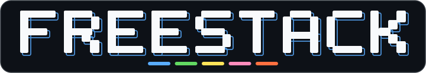

<div align="center">

<a href="https://freestack.ai.studio">
  <picture>
    <source media="(prefers-color-scheme: dark)" srcset="./public/assets/freestack-banner-dark.svg" />
    <source media="(prefers-color-scheme: light)" srcset="./public/assets/freestack-banner-light.svg" />
    
  </picture>
</a>

### **Find more. Spend less. Build anything.**

**🌐 Official Website: [freestack.ai.studio](https://freestack.ai.studio)**

> **One verified workbench for `7,881` genuinely free developer tools, AI inference APIs, MCP servers, cloud tiers, and student perks across `11` stacks — real quotas, explicit card rules, zero trial traps.**

[](https://freestack.ai.studio)
[](https://freestack.ai.studio/explore)
[](https://freestack.ai.studio/categories)
[](./package.json)
[](./tsconfig.json)
[](./src/index.css)
[](./LICENSE)

[**Visit freestack.ai.studio**](https://freestack.ai.studio) · [**What Makes It Different**](#-what-makes-freestack-different) · [**Zero-Dollar Blueprints**](#-ship-for-0-mix--match-blueprints) · [**The 11 Stacks**](#-explore-all-11-stacks) · [**Run Locally**](#-run-locally-in-60-seconds) · [**API & Integrity**](#-api-endpoints--catalog-rules) · [**License**](#-license--attributions)

</div>

---

## ⚡ What Makes FreeStack Different

FreeStack verifies every listing directly against official provider documentation—surfacing real rate limits, exact credit-card rules, and permanent free tiers with zero hidden trial traps or guesswork. Explore the live catalog anytime at **[freestack.ai.studio](https://freestack.ai.studio)**.

<table>
  <tr>
    <td width="50%" valign="top">
      <h3>🪪 Card-Rule Honesty</h3>
      Every single resource declares its exact payment barrier upfront: <strong>No Card Required</strong>, <strong>Card Required</strong>, or <strong>Unknown</strong> — filterable in one click across the entire catalog.
    </td>
    <td width="50%" valign="top">
      <h3>🔍 Real Quotas, Zero Hype</h3>
      Instead of vague <em>"generous free plan"</em> copy, cards show actual rate limits, context windows, reset windows, pricing model classification, and official HTTPS evidence links.
    </td>
  </tr>
  <tr>
    <td width="50%" valign="top">
      <h3>⚡ URL-Synced Discovery</h3>
      Every search, category jump, AI modality filter, MCP runtime scope, and verification toggle updates the URL cleanly — bookmark or share any filtered view with your team.
    </td>
    <td width="50%" valign="top">
      <h3>🎓 Clear Student Separation</h3>
      Student perks explicitly distinguish <strong>Student ID / <code>.edu</code> Required</strong> programs from <strong>No Student ID Needed</strong> resources open to self-taught builders everywhere.
    </td>
  </tr>
</table>

---

## 🧩 Ship for `$0`: Mix & Match Blueprints

Need to ship an idea this weekend without pulling out a wallet? Combine vetted no-card building blocks straight from FreeStack's catalog:

| Goal | `$0` Stack Recipe | Highlights in FreeStack |
| :--- | :--- | :--- |
| **🤖 AI Agent + Tooling App** | Inference API + MCP Server + UI Kit | **NVIDIA Build Models (Free NIM API)** · Google Gemini API · GroqCloud · Official MCP Servers · **GradientDeck UI** |
| **🚀 Full-Stack SaaS MVP** | Edge Hosting + Serverless Postgres + Auth + Docs | Cloudflare Workers & Pages · Supabase · Neon Serverless Postgres · Clerk · Notion Free Workspace |
| **🔐 Secure Self-Hosted Lab** | Mesh VPN + Zero-Trust Tunnel + TLS + Monitoring | Cloudflare Zero Trust · Tailscale Mesh VPN · Let's Encrypt · Sentry · Bruno |
| **🎓 Student Hackathon Pack** | Academic IDE + Cloud Credits + Domains | GitHub Student Developer Pack · Azure for Students ($100) · JetBrains Student · Google Summer of Code |

---

## 📦 Explore All `11` Stacks

Ordered **Most Popular → Least Popular** so everyday builder essentials appear right at the top:

| # | Stack | Route | Verified Offers | Subtypes | Featured Standouts |
| :-: | :--- | :--- | :---: | :---: | :--- |
| `01` | **AI Models** | [`/category/ai-ml`](https://freestack.ai.studio/category/ai-ml) | `86` | `11` | **NVIDIA Build Models (Free NIM API)**, Google Gemini API, GroqCloud, OpenRouter, Ollama, Hugging Face |
| `02` | **MCP** | [`/category/mcp`](https://freestack.ai.studio/category/mcp) | `4,645` | `64` | Official Model Context Protocol servers, inspectors, TypeScript/Python/Rust SDKs, database & browser connectors |
| `03` | **APIs** | [`/category/apis-integrations`](https://freestack.ai.studio/category/apis-integrations) | `2,226` | `56` | Public REST & GraphQL APIs, weather, geocoding, finance, developer utilities, webhooks, testing sandboxes |
| `04` | **Frontend & Design Tools** | [`/category/design-creative`](https://freestack.ai.studio/category/design-creative) | `104` | `8` | **GradientDeck UI**, **getdesign.md**, **Kombai**, Tailwind kits, Figma Education, Lucide, Motion |
| `05` | **Cloud & Hosting** | [`/category/cloud-hosting`](https://freestack.ai.studio/category/cloud-hosting) | `113` | `10` | Cloudflare Pages & Workers, Vercel, Render, Fly.io, Coolify, serverless & container runtimes |
| `06` | **Databases & Backend** | [`/category/databases-backend`](https://freestack.ai.studio/category/databases-backend) | `125` | `10` | Supabase, Neon Serverless Postgres, Upstash Redis, Turso, Drizzle ORM, Appwrite |
| `07` | **Developer Tools** | [`/category/developer-tools`](https://freestack.ai.studio/category/developer-tools) | `106` | `10` | VS Code, GitHub Actions, Postman/Bruno, Docker, Biome, Playwright |
| `08` | **Learning & Study Materials** | [`/category/learning`](https://freestack.ai.studio/category/learning) | `119` | `10` | Harvard CS50x, freeCodeCamp, MDN Web Docs, The Odin Project, roadmap.sh, MIT OCW |
| `09` | **Student Benefits** | [`/category/student-benefits`](https://freestack.ai.studio/category/student-benefits) | `107` | `10` | GitHub Student Pack, JetBrains, Azure $100, AWS Educate, Exercism, fellowships |
| `10` | **Security & Networking** | [`/category/security-networking`](https://freestack.ai.studio/category/security-networking) | `125` | `10` | Cloudflare Zero Trust, Tailscale Mesh VPN, Let's Encrypt, OWASP ZAP, HashiCorp Vault |
| `11` | **Productivity & Collaboration** | [`/category/productivity-collaboration`](https://freestack.ai.studio/category/productivity-collaboration) | `125` | `10` | Notion Free Workspace, Linear, Excalidraw, Obsidian, n8n, Cal.com, Raycast |

---

## 🎯 Built-In Experience Highlights

- **Portal-Rendered Custom Filter Dropdowns** — Accessible `listbox` menus with tabular resource counts, sticker glyphs, keyboard navigation (`↑`, `↓`, `Home`, `End`, `Enter`, `Esc`), and centered popover alignment across Explore, Category, Learning, and Legal views.
- **Contextual Single-Step Back Navigation** — Jump from any search query into an offer breakdown and step straight back without losing your filters or search text.
- **Instant Saved Toolkit** — Bookmark tools locally in your browser (`localStorage`) at `/saved` — zero sign-up required.
- **Crisp Light-First Interface** — High-contrast editorial typography paired with tabular monospace counts (`Plus Jakarta Sans`, `Inter`, `JetBrains Mono`) built on React 19, TypeScript, Tailwind CSS v4, and Express.
- **Zero Auth & Zero Runtime AI Keys** — Everything runs out of the box from a Git-versioned JSON catalog with schema contracts and automated link verification.

---

## 🚀 Run Locally in 60 Seconds

### Prerequisites
- **Node.js** `>= 24.0.0` (pinned in `.nvmrc`) and **npm**

```bash
# 1. Clone the repository
git clone https://github.com/aniketkolse/FreeStack.git
cd FreeStack

# 2. Install locked dependencies
npm ci

# 3. (Optional) Copy environment config — public browsing needs no API keys
cp .env.example .env

# 4. Launch development server at http://localhost:3000
npm run dev
```

For production builds:

```bash
npm run build
SITE_URL=https://your-domain.example.com NODE_ENV=production npm run start:prod
```

### Command Reference

| Script | What It Does |
| :--- | :--- |
| `npm run dev` | Starts Express + Vite middleware on port `3000` |
| `npm run build` | Compiles client bundle (`dist/`) and server bundle (`dist-server/server.js`) |
| `npm run start:prod` | Runs the compiled production server (`node dist-server/server.js`) |
| `npm run verify` | Full release gate: `lint` + `test` (`75` tests) + `validate:data` (`7,881` offers) + `build` |
| `npm run lint` | Runs strict TypeScript compiler checks (`tsc --noEmit`) |
| `npm test` | Executes the unit, catalog contract, and server security test suite |
| `npm run validate:data` | Validates all `7,881` offers against schema, HTTPS, and XSS/URL safety rules |
| `npm run check:links` | Audits outbound `https://` links with SSRF/private-IP protection (`--dry-run` supported) |
| `npm run export:reports` | Exports queued community reports to a timestamped JSON backup |
| `npm run audit:prod` | Runs `npm audit --omit=dev --audit-level=high` |

---

## 🔌 API Endpoints & Catalog Rules

FreeStack ships a hardened Express backend with safe outbound routing, strict Zod validation, and rate-limited catalog endpoints:

| Endpoint | Purpose |
| :--- | :--- |
| `GET /api/health` | Server readiness with live offer and category counts |
| `GET /api/offers` | Paginated, Zod-validated JSON feed (`?q=`, `?category=`, `?card=`, `?pricing=`, `?sort=`, `?limit=24&offset=0`, max `limit=100`) |
| `GET /api/quality-report` | Catalog verification breakdown (`verified`, `unverified`, `needs_review`, `expired`) & source coverage |
| `POST /api/reports` | Same-origin, rate-limited (`5/hr`), Zod-validated community correction & resource submission queue |
| `GET /api/reports` | Disabled by default (`404`); requires `Authorization: Bearer <ADMIN_TOKEN>` (`>= 32` chars) when enabled |
| `GET /go/:slug` | Safe allowlisted outbound redirect (`official`, `signup`, `docs`, `pricing`) with domain-family verification |
| `GET /sitemap.xml` & `GET /robots.txt` | Cached SEO sitemap & robots rules built strictly from `SITE_URL` |

<details>
<summary><strong>📜 Contributing & Verification Guardrails (Expand to Read)</strong></summary>

Every published resource is version-controlled under `data/offers/<category>/` so pricing or quota changes have clean Git diffs. See [**CONTRIBUTING.md**](./CONTRIBUTING.md) for the full contributor workflow.

Before opening a Pull Request:
1. **Official HTTPS Sources Only** — Official links, docs, and cited sources must use `https://` (no URL shorteners, IP literals, credentials, or `utm_*` tracking parameters).
2. **Evidence-Backed** — Verified entries cite official pricing or documentation URLs and factual claim snippets; bulk-imported entries default to `status: "unverified"` until human review.
3. **No Disguised Trials** — Time-limited plans must declare `pricing_model: "free_trial"` with an explicit `trial_period`.
4. **Honest Unknowns** — Never guess missing card rules or quotas; preserve `"unknown"` when official docs are silent.
5. **Pass All Checks**:
   ```bash
   npm run verify
   ```

</details>

---

## 🔒 Security & Deployment

- **Zero Third-Party Browser Requests**: Variable fonts (`@fontsource-variable/*`) and all `7,881` provider logos (`/logos/*`) are self-hosted on-origin under a strict Content Security Policy (`default-src 'self'`, `script-src 'self'`, `img-src 'self' data:`, `frame-ancestors 'none'`).
- **Hardened Server & Outbound Redirects**: Enforces `helmet` security headers, `express-rate-limit`, Zod input schemas, SSRF-safe link checking, and domain-verified `/go/:slug` redirects.
- **Deployment Guide**: See [**DEPLOY.md**](./DEPLOY.md) for production environment variables, reverse-proxy/TLS setup, and the 20-point launch security checklist.
- **Vulnerability Disclosure**: Read our [**Security Policy**](./SECURITY.md) (also published at [`/.well-known/security.txt`](./public/.well-known/security.txt)) for responsible disclosure steps.

---

## 📄 License & Attributions

- **License**: FreeStack is licensed under the **GNU Affero General Public License v3.0 (AGPL-3.0)** (Copyright © 2026 **Aniket Kolse**) — see [**LICENSE**](./LICENSE) and [**NOTICE**](./NOTICE).
  - Anyone can freely browse [freestack.ai.studio](https://freestack.ai.studio), run FreeStack locally, or build upon the codebase under AGPL-3.0 terms.
  - Any modified version or network-hosted instance (including forks, mirrors, or SaaS deployments) must preserve attribution and copyright notices, remain licensed under **AGPL-3.0**, and make its complete corresponding source code publicly available to all users interacting with it over a network.
- **Third-Party Catalog & Font Attributions**: See [**THIRD_PARTY_NOTICES.md**](./THIRD_PARTY_NOTICES.md) for MIT/ISC/BSD/OFL upstream dataset and font attributions.
- **Non-Affiliation Disclaimer**: All third-party product names and logos belong to their respective owners and are used strictly for nominative identification. Free tiers, quotas, and card requirements can change at any time — always verify current pricing on the provider's official documentation before deploying workloads.

---

<div align="center">

**🌐 Explore the live directory at [freestack.ai.studio](https://freestack.ai.studio)**

**Star ⭐ the repo if FreeStack helped you ship your next project for `$0`.**

</div>

