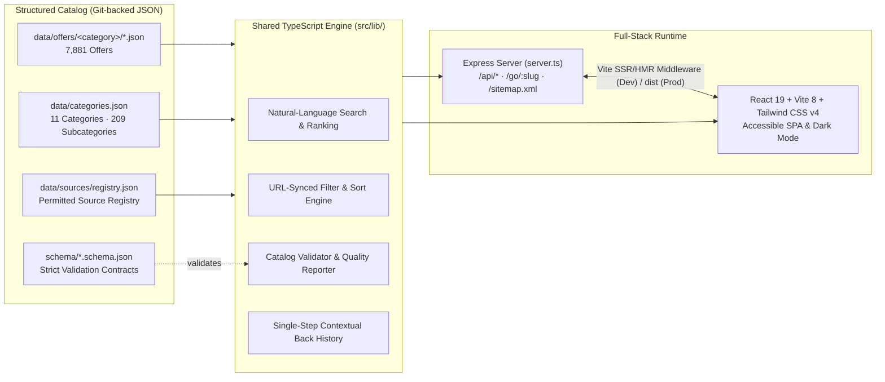

<div align="center">

# FreeStack

### **Find more. Spend less. Build anything.**

**A verified, source-cited directory of `7,881` genuinely free developer resources across `11` stacks — real quotas, explicit credit card rules, zero trial traps.**

[](./data/offers)
[](./data/categories.json)
[](./package.json)
[](./tsconfig.json)
[](./src/index.css)

[Features](#-why-freestack) · [Catalog Stacks](#-the-11-stacks-7881-resources) · [Architecture](#-architecture) · [Quick Start](#-quick-start) · [API & Routes](#-backend-api--endpoints) · [Validation](#-data-schema--verification)

</div>

---

## ✨ Why FreeStack?

Most "free developer tool" lists hide credit-card walls, mix 14-day trials with permanent free tiers, or bury actual rate limits behind marketing fluff. **FreeStack** treats free-tier metadata as structured, verifiable engineering data:

- **Zero Trial Traps** — Every entry explicitly separates `completely_free`, `free_tier`, `open_source`, `freemium`, `free_credits`, `student_exclusive`, and `free_trial` with exact limits and reset windows.
- **Explicit Credit Card Rules** — Filter instantly for `No credit card required`, `Card required`, or `Unknown` across the entire directory.
- **Source-Cited Claims** — Every offer record lives as structured JSON backed by official HTTPS pricing/documentation links and verified claim quotes.
- **Instant URL-Synced Filtering** — Shareable `/explore` queries across category, subcategory, resource type, pricing model, payment card rule, student eligibility, and verification status.
- **Bespoke Accessible Controls** — Portal-rendered category, type, and status dropdowns with sticker icons, tabular counts, full keyboard navigation (`↑` `↓` `Home` `End` `Enter` `Esc`), and smooth light/dark mode.
- **Contextual Single-Step Back Navigation** — Inspecting any resource from a searched category or filtered view preserves your exact search query and previous step on back navigation.
- **Privacy & Compliance Ready** — Built-in Legal & Privacy Center (`India DPDP Act 2023`, `US CCPA/CPRA`, `EU/UK GDPR`) and safe `/go/:slug` outbound redirects with zero open-redirect exposure.

---

## 📦 The 11 Stacks (`7,881` Resources)

| Stack | Route | Resources | Subcategories | Spotlight Highlights |
| :--- | :--- | :---: | :---: | :--- |
| **AI Models** | `/category/ai-ml` | `86` | `11` | **NVIDIA Build Models (Free NIM API)**, Google Gemini API, GroqCloud, OpenRouter, Ollama, Hugging Face |
| **MCP** | `/category/mcp` | `4,645` | `64` | Official Model Context Protocol servers, inspectors, SDKs, browser automation, and database connectors |
| **APIs** | `/category/apis-integrations` | `2,226` | `56` | Public REST & GraphQL APIs, weather, geocoding, finance, webhooks, and testing sandboxes |
| **Frontend & Design Tools** | `/category/design-creative` | `104` | `8` | **GradientDeck UI**, **getdesign.md**, **Kombai**, Tailwind UI kits, Figma Education, Lucide, Motion |
| **Cloud & Hosting** | `/category/cloud-hosting` | `113` | `10` | Cloudflare Pages & Workers, Vercel, Render, Fly.io, Coolify, Kubernetes & serverless compute |
| **Databases & Backend** | `/category/databases-backend` | `125` | `10` | Supabase, Neon Serverless Postgres, Upstash Redis, Turso, Drizzle ORM, Clerk, Appwrite |
| **Developer Tools** | `/category/developer-tools` | `106` | `10` | VS Code, GitHub Actions, Postman/Bruno, Sentry, Docker, Biome, Playwright |
| **Learning & Study Materials** | `/category/learning` | `119` | `10` | Harvard CS50x, freeCodeCamp, MDN Web Docs, The Odin Project, roadmap.sh, MIT OCW |
| **Student Benefits** | `/category/student-benefits` | `107` | `10` | **ID / `.edu` Required** (GitHub Student Pack, JetBrains, Azure $100) & **No ID Needed** (AWS Educate, GSoC, Exercism) |
| **Security & Networking** | `/category/security-networking` | `125` | `10` | Cloudflare Zero Trust, Tailscale Mesh VPN, Let's Encrypt, OWASP ZAP, HashiCorp Vault, WireGuard |
| **Productivity & Collaboration** | `/category/productivity-collaboration` | `125` | `10` | Notion Free Workspace, Linear, Excalidraw, Obsidian, n8n, Cal.com, Raycast |

> Every stack is ordered **Most Popular → Least Popular** by default so high-signal tools surface immediately.

---

## 🎨 Key Application Views

- **`/` Home** — Hero overview with quick search, curated popular stack cards, recently verified highlights, and direct entry points.
- **`/explore` & `/search`** — Full-catalog search and multi-faceted URL-synced filtering with responsive desktop sticky sidebar, mobile slide-up filter drawer, custom `FilterDropdown` menus, segmented sorting (`Relevance`, `Verified`, `Newest`, `A–Z`), and active removable filter chips.
- **`/categories` & `/category/:slug`** — Dedicated stack hubs featuring subcategory filtering, search within category, AI modality/context-window badges (in AI Models), and Student ID vs. No-ID classification.
- **`/offer/:slug`** — Detailed resource breakdown: verified quotas, rate limits, payment card rule, student eligibility, official links (`/go/:slug`), source-cited evidence claims, related tools, and outdated-info reporting.
- **`/learning`** — Focused study hub across programming courses, CS fundamentals, interactive sandboxes, roadmaps, and free technical books.
- **`/students`** — Dedicated guide separating Student ID / `.edu` academic packs from open-access student programs.
- **`/saved`** — Personal browser-persisted (`localStorage`) toolkit bookmark manager with one-click share/export.
- **`/about`, `/design-system`, `/privacy`, `/privacy-requests`, `/terms`** — Project transparency, interactive UI token showcase, and compliance portals.

---

## 🏗 Architecture



---

## 🛠 Tech Stack

| Layer | Technology |
| :--- | :--- |
| **Frontend** | React `19`, TypeScript (strict), Tailwind CSS `v4`, `lucide-react`, `motion` |
| **Typography** | `Plus Jakarta Sans` (display), `Inter` (UI/body), `JetBrains Mono` (tabular quotas & counts) |
| **Backend** | Express `4`, Node.js, Vite `8` middleware (dev) & static `dist/` serving (prod) |
| **Data & Validation** | File-based JSON catalog under `data/offers/`, JSON Schemas in `schema/`, custom validator & link checker |
| **Testing** | Node built-in `node:test` + `tsx` (`53` unit & catalog contract tests) |

---

## 📁 Project Structure

```text
freestack/
├── data/
│   ├── categories.json          # 11 categories, color tokens, and 209 subcategories
│   ├── offers/                  # 7,881 offer JSON files organized by category slug
│   └── sources/registry.json    # Permitted official documentation & pricing sources
├── schema/
│   ├── offer.schema.json        # Offer contract (limits, card rules, claims, links)
│   ├── category.schema.json     # Category taxonomy schema
│   └── source.schema.json       # Source registry schema
├── scripts/
│   ├── validate-data.ts         # Validates all 7,881 offers against schema & rules
│   ├── check-links.ts           # Verifies outbound HTTPS links across catalog
│   ├── scrape-awesome-mcp-servers.ts
│   └── scrape-public-apis.ts
├── src/
│   ├── components/
│   │   ├── categories/          # Category grid & navigation cards
│   │   ├── illustrations/       # Custom FreeStack logo & category sticker SVGs
│   │   ├── layout/              # Header, footer, and animated stack intro splash
│   │   ├── offers/              # ResourceCard, OfferLogo, ReportOutdatedModal
│   │   ├── search/              # Natural-language SearchBar
│   │   └── ui/                  # Portal-positioned accessible FilterDropdown
│   ├── lib/
│   │   ├── ai/                  # AI modality & context-window metadata extractors
│   │   ├── data/                # Vite glob loader & Node disk loader
│   │   ├── filters/             # URL-synced filter state & sort engine
│   │   ├── router/              # Custom client router & single-step back history
│   │   ├── search/              # Ranked keyword & natural-language search
│   │   ├── validation/          # Offer contract validator & change detector
│   │   └── verification/        # Verification diff & failure resilience logic
│   ├── pages/                   # Home, Explore, Categories, Learning, Students, OfferDetail, etc.
│   └── types/                   # Shared TypeScript domain interfaces
├── server.ts                    # Express API, /go/:slug allowlisted redirects, SEO & SPA host
├── index.html                   # App entry point & OpenGraph metadata
└── package.json
```

---

## 🚀 Quick Start

### Prerequisites

- **Node.js** `>= 20`
- **npm** (or `bun`)

### 1. Clone & Install

```bash
git clone https://github.com/<your-username>/freestack.git
cd freestack
npm install
```

### 2. Configure Environment (Optional)

Public browsing requires **no database** and **no runtime API keys**. To customize the port or canonical URL for sitemap generation, copy `.env.example`:

```bash
cp .env.example .env
```

### 3. Run in Development

Starts the Express server with Vite middleware on **`http://localhost:3000`**:

```bash
npm run dev
```

### 4. Build & Run in Production

```bash
npm run build
npm start
```

---

## 🧪 Scripts & Quality Checks

| Command | Description |
| :--- | :--- |
| `npm run dev` | Start Express + Vite development server on port `3000` |
| `npm run build` | Build production frontend bundle into `dist/` |
| `npm start` | Serve the production Express + static bundle server |
| `npm run lint` | Run strict TypeScript type-checking (`tsc --noEmit`) |
| `npm test` | Run all `53` unit & catalog validation tests (`node:test` via `tsx`) |
| `npm run validate:data` | Validate all `7,881` JSON offers against schema and business rules |
| `npm run check:links` | Check outbound HTTPS links across catalog entries |

---

## 🔌 Backend API & Endpoints

| Method & Path | Purpose |
| :--- | :--- |
| `GET /api/health` | Returns server status and live category, offer, and source counts |
| `GET /api/offers` | Queryable catalog endpoint supporting `?q=`, `?category=`, `?card=`, `?pricing=`, `?sort=` |
| `GET /api/quality-report` | Returns catalog verification summary and source registry health |
| `GET /api/reports` | Lists community-submitted outdated-info or new-resource reports |
| `POST /api/reports` | Submits an outdated limit, card rule change, or new resource suggestion (`https://` validated) |
| `GET /go/:slug` | Safe allowlisted outbound redirect (`official`, `signup`, `docs`, `pricing`) — blocks open redirects |
| `GET /sitemap.xml` | Dynamically generated XML sitemap across all static pages, categories, and `7,881` offers |
| `GET /robots.txt` | Crawler directives disallowing `/go/` redirects and linking `/sitemap.xml` |

---

## 🛡️ Data Schema & Contributing

Every resource is stored as an individual JSON document under `data/offers/<category>/<slug>.json` so diffs remain clean and reviewable in Git.

<details>
<summary><strong>Verification Rules Enforced by <code>npm run validate:data</code></strong></summary>

1. **HTTPS Only**: `links.official` and all evidence/logo URLs must use `https://` (no `http://` or `javascript:` schemes).
2. **Evidence Required**: Verified resources must cite at least one official source and claim quote.
3. **Honest Free Trials**: `pricing_model: "free_trial"` must explicitly specify a `trial_period` (never disguised as a permanent free tier).
4. **Accurate Student Classification**: `pricing_model: "student_exclusive"` requires `eligibility.student_access === "exclusive"`.
5. **Chronological Integrity**: `metadata.updated_at` cannot precede `metadata.created_at`, and slugs/IDs must be globally unique.

</details>

To contribute a new free resource or update a quota:
1. Add or edit the JSON file under `data/offers/<category>/<slug>.json`.
2. Cite the official pricing or documentation page in `verification.sources`.
3. Run `npm run validate:data && npm test && npm run lint` before opening a Pull Request.

---

<div align="center">

Built with **React 19**, **TypeScript**, **Tailwind CSS v4**, and **Express** — **FreeStack**

</div>
